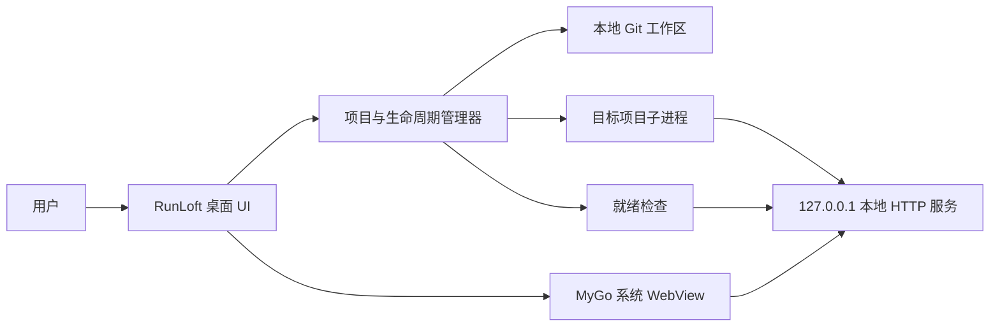
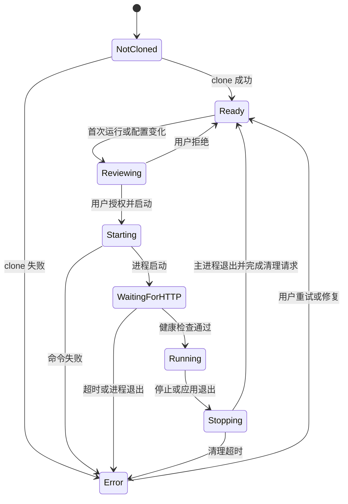

# 架构与生命周期

## 1. 架构概览

RunLoft 是本机控制面，不是目标 Web 应用的服务端。目标项目仍在本机工作区按原有方式运行；RunLoft 负责协调 Git、命令执行、就绪检查和桌面 WebView。

## 2. 逻辑组件

### 桌面界面

提供项目列表、添加项目、命令审查、启动/停止控制、运行状态、服务页面和日志入口。RunLoft 自己的控制界面与目标项目页面应保持明确边界。

### 项目管理器

保存本地项目元数据，定位工作区，读取与校验 `.runloft.yaml`，协调更新和生命周期状态。项目登记、远端来源和配置授权摘要存放在操作系统提供的应用数据目录，不写进目标项目仓库。移除项目只清除登记，不删除代码工作区。

### Git 适配器

通过系统 Git 客户端执行 clone、fetch、status 和受限的更新操作。MVP 不静默 reset、clean 或覆盖工作区；工作区不干净时阻止更新操作。

### 命令执行器

在解析并校验工作目录后运行配置命令；准备步骤按序执行，逐步收集标准输出和错误输出并记录退出码与进程状态。命令通过 argv 数组执行，不经过 shell。Unix 为每个目标命令创建独立进程组；Windows 将目标进程放入关闭时终止成员的 Job Object，并用 `taskkill /T` 发起优雅停止。Windows 设备上的运行行为仍待验证。

### 服务探测与 WebView

服务探测器轮询配置的 loopback 健康地址。健康检查只接受 2xx、401、403，不跟随重定向；若项目从日志中动态打印入口 URL，RunLoft 需校验它与配置的 loopback origin/port 一致后再加载 WebView。用户主动触发的跨域 HTTP(S) 导航在校验 URL 凭据并移除敏感查询参数和片段后交给系统浏览器；`target="_blank"` 和 `window.open` 请求先经原生确认，再由用户选择是否打开。

## 3. 项目状态

具体状态名称属于实现细节，但 UI 必须区分“命令正在运行”和“网页服务已经可访问”。

## 4. 启动流程

1. 检查 Git 工作区是否干净；存在未提交或非忽略的未跟踪文件时停止并提示先提交。
2. 解析仓库配置并校验 schema 版本、工作目录、命令和本地 URL；把仓库身份、HEAD commit 和解析配置绑定到授权摘要。
3. 执行配置声明的白名单运行时版本探针；探针使用固定参数且在命令授权对话框前运行。RunLoft 不自动安装或更新运行时。
4. 若当前摘要尚未授权，展示命令和目录供用户审查；用户确认后再次检查提交、配置和工作区状态，变化时取消执行。
5. `prepare.steps` 只能由用户主动触发，按序执行；任一步失败即停止，不在 clone 或每次启动时静默执行。启动前检查端口可用性。
6. 在目标仓库目录启动子进程，继承 RunLoft 的完整环境并设置 `RUNLOFT_PORT`。
7. 缓冲并显示日志；在超时范围内轮询 HTTP 健康检查。
8. 健康检查成功后，让 MyGo WebView 加载配置的 loopback URL。
9. 停止时先请求优雅退出；超时后向 RunLoft 创建的进程组/Job Object 请求强制清理，并等待主进程退出。当前不会单独确认每个后代进程均已结束。

## 5. Git 更新流程

1. 用户主动检查更新时，先检查仓库状态；工作区不干净时停止并展示本地改动。
2. 工作区干净时 fetch 远端并展示可更新的目标提交。
3. 只有用户明确确认后才应用更新，且仅允许无冲突快进；分支分叉时停止。
4. 不执行 `reset --hard`、`clean -fd` 或等效的数据丢弃操作。
5. 更新后重新校验配置授权；新配置内容需要用户再次审查。

首次克隆的完整用户交互待原型确认。私有仓库凭据由系统 Git 凭据助手或 SSH 配置处理，MVP 不自行保存明文令牌。

## 6. 本地服务约束

- 目标服务默认绑定 `127.0.0.1`，而不是 `0.0.0.0`。
- MVP 优先使用仓库配置中的固定端口，并检查端口冲突。动态端口分配要等目标项目能可靠接收并报告端口后再设计。
- WebView 加载前必须完成就绪检查；启动命令保持运行并不代表 HTTP 服务已就绪。
- 校验 URL 的 scheme、host 和 port；拒绝任意远程地址、文件 URL 和配置目录之外的跳转。
- MyGo 0.6.0 提供应用级浏览数据清理，没有为本项目配置独立 WebView profile 的接口。RunLoft 在每次打开目标页面前清理 MyGo 应用浏览数据，以防不同仓库共享状态；因此项目 Cookie/localStorage 不跨次保留。
- 一个 RunLoft 实例当前只允许一个活动项目，先停止当前项目才能切换工作区。

## 7. 技术边界与验证项

当前方向为 Go + MyGo 0.6.0。MyGo 提供使用系统 WebView 的桌面窗口能力；非应用自有网页不能调用 Go 绑定。因此，目标项目页面与 RunLoft 的本机控制能力分离：RunLoft 控制命令和生命周期，目标页面通过本机 HTTP 服务提供自身功能。`cmd/runloft` 已接入本机工作区列表、Git、配置授权、版本诊断、prepare/start/stop 和服务 WebView；具体平台验收结果以[技术验证记录](VALIDATION.md)为准。

实现后仍需完成的平台与人工验证：

- macOS Apple Silicon 的最小 WebView 已验证 HTTP、Cookie、WebSocket 和 SPA 路由；Windows 11 x64 与完整 RunLoft 主应用仍需验证 loopback、重定向及项目页面行为。
- 在 Windows 11 x64 与 macOS 14+（Apple Silicon）上人工验收窗口关闭、应用退出时对子进程的清理行为；Windows Job Object 实现尚无目标设备实测。
- WebView 数据目前在加载项目前清除应用级浏览数据；需继续人工验收项目间隔离、外链/新窗口确认和浏览器开发工具策略。
- 系统 Git 与命令进程的进程组/Job Object 清理请求已实现；后代进程结束状态不单独确认，首发平台实机验收及 Linux 行为仍待确认。

参考： [MyGo Getting started](https://mygo.egoist.dev/docs/getting-started)、[MyGo Web view](https://mygo.egoist.dev/docs/ui/web-view)、[MyGo Building and distributing](https://mygo.egoist.dev/docs/distribution)。
