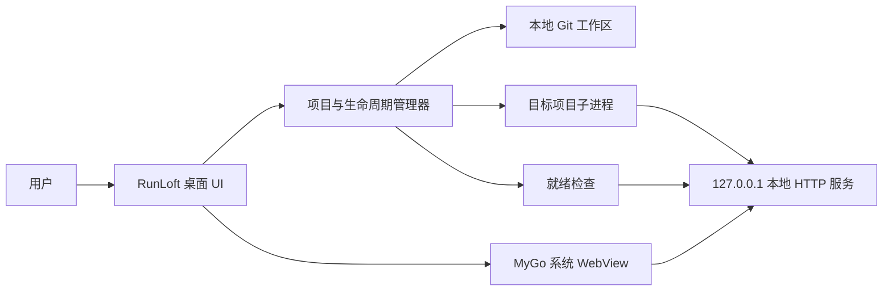
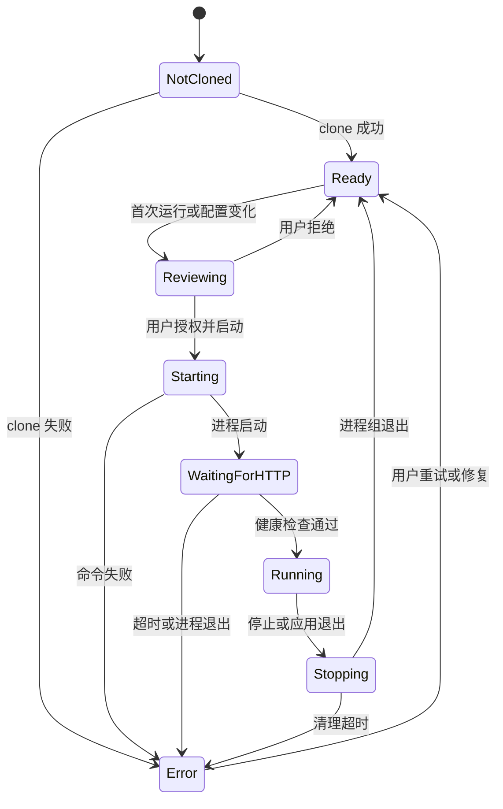

# 架构与生命周期

## 1. 架构概览

RunLoft 是本机控制面，不是目标 Web 应用的服务端。目标项目仍在本机工作区按原有方式运行；RunLoft 负责协调 Git、命令执行、就绪检查和桌面 WebView。

## 2. 逻辑组件

### 桌面界面

提供项目列表、添加项目、命令审查、启动/停止控制、运行状态、服务页面和日志入口。RunLoft 自己的控制界面与目标项目页面应保持明确边界。

### 项目管理器

保存本地项目元数据，定位工作区，读取与校验 `.runloft.yaml`，协调更新和生命周期状态。用户数据应保存在操作系统提供的应用数据目录，不应写进目标项目仓库。

### Git 适配器

通过系统 Git 客户端执行 clone、fetch、status 和受限的更新操作。MVP 不静默 reset、clean 或覆盖工作区；工作区不干净时阻止更新操作。

### 命令执行器

以项目根目录为基准运行配置命令；准备步骤按序执行，逐步收集标准输出和错误输出并记录退出码与进程状态。应能停止由 RunLoft 启动的整组进程，而不是只结束最外层命令。

### 服务探测与 WebView

服务探测器轮询配置的本地健康地址。健康检查通过后，窗口再加载 WebView。WebView 只允许进入配置的 loopback 服务；外部链接交由系统浏览器处理。

## 3. 项目状态

具体状态名称属于实现细节，但 UI 必须区分“命令正在运行”和“网页服务已经可访问”。

## 4. 启动流程

1. 解析仓库配置并校验 schema 版本、工作目录、命令和本地 URL。
2. 计算配置摘要；从未授权或摘要改变时，展示命令和目录供用户审查。
3. 检查本机依赖和端口可用性。RunLoft 只诊断运行时，不自动安装或更新；缺少时提示用户。`prepare.steps` 只能由用户主动触发，按序执行；任一步失败即停止，不在 clone 或每次启动时静默执行。
4. 在目标仓库目录启动子进程，继承必要环境并添加 RunLoft 定义的变量。
5. 缓冲并显示日志；在超时范围内轮询 HTTP 健康检查。
6. 健康检查成功后，让 MyGo WebView 加载配置的 loopback URL。
7. 停止时先请求优雅退出；超时后结束由 RunLoft 创建的进程组，并确认端口释放。

## 5. Git 更新流程

1. 用户主动检查更新时，先检查仓库状态；工作区不干净时停止并展示本地改动。
2. 工作区干净时 fetch 远端并展示可更新的目标提交。
3. 只有用户明确确认后才应用更新，且仅允许无冲突快进；分支分叉时停止。
4. 不执行 `reset --hard`、`clean -fd` 或等效的数据丢弃操作。
5. 更新后重新校验配置授权；新配置内容需要用户再次审查。

首次克隆的完整用户交互待原型确认。私有仓库凭据由系统 Git 凭据助手或 SSH 配置处理，MVP 不自行保存明文令牌。

## 6. 本地服务约束

- 目标服务默认绑定 `127.0.0.1`，而不是 `0.0.0.0`。
- MVP 优先使用仓库配置中的固定端口，并检查端口冲突。动态端口分配要等目标项目能可靠接收并报告端口后再设计。
- WebView 加载前必须完成就绪检查；启动命令保持运行并不代表 HTTP 服务已就绪。
- 校验 URL 的 scheme、host 和 port；拒绝任意远程地址、文件 URL 和配置目录之外的跳转。
- Cookie、localStorage 和 WebView profile 的隔离策略需在技术验证阶段确定，避免不同仓库之间共享认证状态。

## 7. 技术边界与验证项

当前方向为 Go + MyGo。MyGo 提供使用系统 WebView 的桌面窗口能力；它的文档还指出，非应用自有网页不能调用 Go 绑定。因此，目标项目页面与 RunLoft 的本机控制能力应分离：RunLoft 控制命令和生命周期，目标页面通过本机 HTTP 服务提供自身功能。

实现前必须验证：

- MyGo WebView 能否可靠加载 `http://127.0.0.1:<port>` 并处理项目常见的 cookie、WebSocket、重定向和前端路由。
- 在 Windows 11 x64 与 macOS 14+（Apple Silicon）上关闭窗口、应用退出、崩溃恢复时对子进程的清理行为。
- 多项目之间的 WebView 存储隔离、外链处理和浏览器开发工具策略。
- 系统 Git 与命令进程在首发平台上的进程树终止实现。

参考： [MyGo Getting started](https://mygo.egoist.dev/docs/getting-started)、[MyGo Web view](https://mygo.egoist.dev/docs/ui/web-view)、[MyGo Building and distributing](https://mygo.egoist.dev/docs/distribution)。
